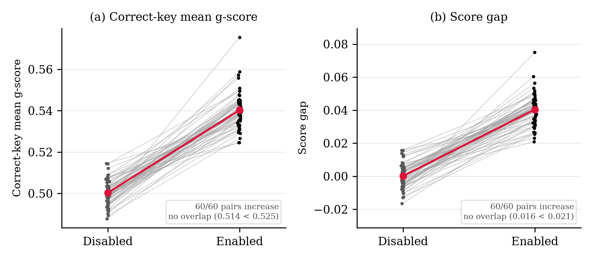

# SynthID-Text in Chinese-to-English machine translation

**A Paired Experiment on Keyed Watermarks and Lexical Features in Chinese to English Translation**

[Read the paper (v28, PDF)](manuscript/v28.pdf) · [View the results (CSV)](results/summary_statistics.csv) · [Download the Appendix A reproducibility archive](manuscript/v20_reproducibility.zip)

Does a watermark embedded as a model translates Chinese into English leave a detectable signal? Does it also affect the words the model uses? Qwen2.5-3B-Instruct translated each of 60 Chinese science and academic passages twice, once with SynthID-Text enabled and once with it disabled. The model, prompt, sampling settings and seed were the same for both translations of a passage. Each pair was matched for length before scoring.

## Results

The watermarked translation scored higher on both detection measures in all 60 pairs. With the correct key, the mean score rose from 0.5003 to 0.5403. Under five incorrect key sets, the mean changed little, from 0.5002 to 0.4999. Neither vocabulary diversity nor local phrase repetition showed a clear average change.

| Outcome | Watermark off | Watermark on | Mean paired difference | 95% cluster bootstrap interval |
|---|---:|---:|---:|---:|
| Correct-key mean g-score | 0.5003 | 0.5403 | +0.0399 | [0.0372, 0.0428] |
| Score gap | 0.0001 | 0.0404 | +0.0402 | [0.0372, 0.0434] |
| Moving-average type-token ratio (MATTR) | 0.8094 | 0.8099 | +0.0005 | [−0.0059, 0.0067] |
| Repeated trigram ratio | 0.0446 | 0.0466 | +0.0020 | [−0.0057, 0.0093] |

Table 1 of the paper reports mean within-passage differences (on minus off). The 60 passages came from 49 source files. To account for passages from the same file, the analysis resampled whole files 10,000 times (seed 20261115). The [full-precision results](results/summary_statistics.csv) also include the original paired t tests and the two sensitivity analyses in Appendix B.



*Figure 1 from the paper.* Each gray line connects the two translations of one passage. Red dots show the condition means. The right panel shows the correct-key score minus the mean score under five independently generated incorrect key sets.

These results support a key-specific signal in this sample. The study used one model and one translation direction, with no human-written controls, fixed classification threshold, or independent calibration and test sets. The lexical intervals allow small changes in either direction. Translation quality and detection accuracy on new texts remain open questions.

## Verify the paper’s results

From the repository root, run the following with Python. The verifier needs NumPy and SciPy and runs on a CPU using the saved scores.

```bash
python -m pip install numpy scipy
python -m zipfile -e manuscript/v20_reproducibility.zip _local/v28-repro
python -B _local/v28-repro/verify_cached_results.py
```

The verifier checks the archive’s file hashes and recomputes all four outcomes for the full sample (60 pairs, 49 files), the main passages (50 pairs, 49 files), and pairs without residual Chinese characters (54 pairs, 44 files). It checks the original paired tests and the source-file bootstrap intervals. The two subsets overlap with the full sample. The cluster and subset checks were exploratory additions after the original analysis.

Appendix A refers to the archive by its original filename, `v20_reproducibility.zip`. It contains the inputs and analysis used in v28, including the exact prompts, key settings, passage-to-file mapping, recorded package versions and per-passage scores.

To redraw Figure 1 and the supplementary plots and tables from the saved CSVs, install the numerical and plotting packages and run the figure script. It writes the assets to `results/`.

```bash
python -m pip install numpy scipy matplotlib
python scripts/make_paper_assets.py
```

## Data and analysis files

| File | Contents |
|---|---|
| [Paired translations](data/translation_results.csv) | Chinese passages and both English outputs. The 50 main and 10 reserve passages came from LCMC category J and span 400–597 Chinese characters. |
| [Per-passage metrics](data/metrics_per_item.csv) and [key comparisons](data/score_gap_results.csv) | Matched-length lexical measures, correct-key scores and comparisons with five incorrect key sets. |
| [Summary statistics](results/summary_statistics.csv) | Means, paired differences, cluster intervals and original test results for all three samples. |
| [Original paired t tables](results/tables.md) and [supplementary forest plot](results/fig2_forest.png) | Earlier passage-level intervals. The paper reports source-file cluster intervals in Table 1 and uses the paired plot as Figure 1. |
| [Analysis scripts](scripts/) and [original analysis log](results/metrics_summary.md) | Generation, scoring, lexical definitions, original statistical checks, and figure generation. |

## Generation and scoring

To run the generation and scoring scripts, install the [analysis requirements](requirements.txt), obtain the Qwen2.5-3B-Instruct model and tokenizer, and set `QWEN_MODEL_DIR` to their local directory. The recorded run used PyTorch 2.11.0 with CUDA 12.8 and Transformers 5.22.2. From the repository root, a three-passage generation run can write to a new CSV:

```bash
python scripts/run_experiment_synthid.py --limit 3 --out data/regenerated-sample.csv
```

Omit `--limit 3` and choose a separate output file for a full run. The generation script skips passage IDs already present in its output. The source archive records the prompt and seed (42 for each translation). The original model revision and generated token IDs were not saved, which limits exact replay.

For all four measures, each pair was trimmed to the shorter translation’s whitespace word count and rejoined with single spaces. The detector re-tokenized these matched texts and averaged g-values over valid positions and key depths. The stored scores use a CUDA-generated sampling table. Initializing the table on a CPU with the same seed produces different values. To check the published numbers on a CPU, use the archive verifier above. To rescore with the model tokenizer and matching CUDA settings, run `scripts/compute_metrics.py` and then `scripts/compute_score_gap.py` in a separate checkout because they write to the tracked result files.

MATTR averages the proportion of distinct words in 50-word windows. The repeated trigram ratio counts every occurrence, including the first, of three-word sequences that occur at least twice, divided by the total number of three-word occurrences.

## Citation and license

Liu, C. (2026). *A paired experiment on keyed watermarks and lexical features in Chinese to English translation*. ENG2001 course paper, The Chinese University of Hong Kong, Shenzhen. [Manuscript](manuscript/v28.pdf) · [Citation metadata](CITATION.cff)

The [MIT License](LICENSE) covers the code. The Chinese source passages retain the terms of the Lancaster Corpus of Mandarin Chinese (LCMC).
